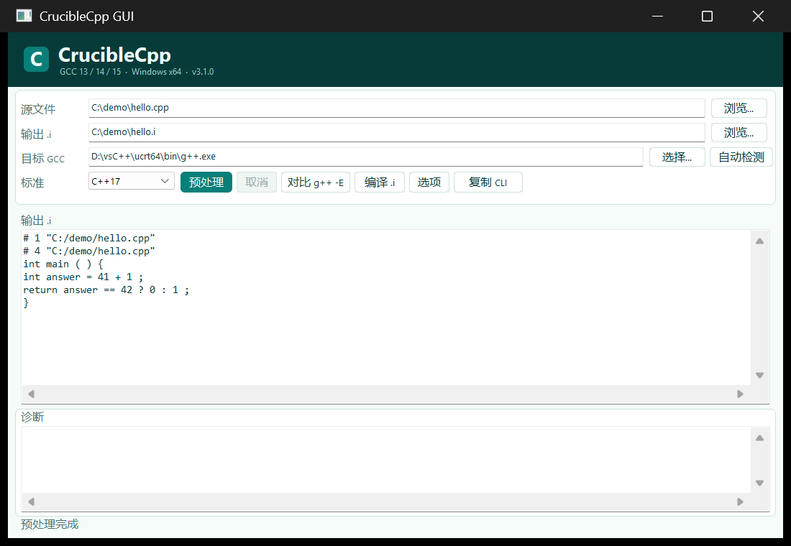

# CrucibleCpp Preprocessor V3.1.0

Windows x64 standalone C++ preprocessor for GCC 13.3 / 14.3 / 15.2.

GUI 从 V3.1.0 起作为正式组件发布，和 CLI 共用同一套核心。



## Windows GUI（正式版）

- 原生 Win32 GUI，和 CLI 共用 `cpp_preproc`，不依赖 Qt / WebView2 / Electron / Dear ImGui。
- 源文件和输出 `.i` 路径必须显式选择；空路径点击“预处理”提示“请先选择目录”。
- GCC 自动检测、C++11/14/17/20、工作线程预处理、取消。
- Include 目录、宏定义、PCH 策略、行标记、保留注释选项。
- 与 `g++ -E` 对比：忽略行标记和空行，差异显示在诊断区。
- 编译 `.i`：强制按 C++ 编译，抑制系统头文件警告噪音，输出 `.exe`。
- 设置持久化、拖放源文件、复制等价 CLI 命令。
- 自绘按钮、悬停动画、DPI 与窗口尺寸自适应布局。

## 修复

- 只读输出/诊断控件滚动时旧文字残留、完全重叠。
- C++ 标准下拉框和“预处理”按钮重叠。
- 高 DPI 下信息区没有铺满窗口。

## 验证

- CLI `--version`：`cruciblecpp-preprocessor 3.1.0`。
- CLI 实际预处理、生成 `.i`、GCC 编译通过。
- GUI 实际完成预处理并生成 `.i`。
- GUI 与 CLI 共用同一核心。

## 许可证

V3.0.0 及以后为 CC BY-NC 4.0；V2.9.0 及以前为 MIT，见 `LICENSE` / `LICENSE-MIT`。

## 资产

- `cruciblecpp-preprocessor.exe`
- `cruciblecpp-preprocessor-v3.1.0-win64.zip`
- `cruciblecpp-gui.exe`
- `cruciblecpp-preprocessor-v3.1.0-win64-gui.zip`
- `SHA256SUMS.txt`

## SHA-256

```text
138ea2c3a390f2c7148d335f5d9056a5f47dfe72bc134d8a2a3bcdeb1d61290b  cruciblecpp-preprocessor.exe
097d71f02dc096c89b6a6f2a99e3effa2d0bdc7ff2dc4f2085829103745a20f2  cruciblecpp-preprocessor-v3.1.0-win64.zip
e953676a210dd9202d63a5e5779717eada27513a3079130507cf391d2e7b55d9  cruciblecpp-gui.exe
3e1d13c62625bb2f09f42213d531d9da2b96967acfd01a7780bf24c78ee6f2f1  cruciblecpp-preprocessor-v3.1.0-win64-gui.zip
```
